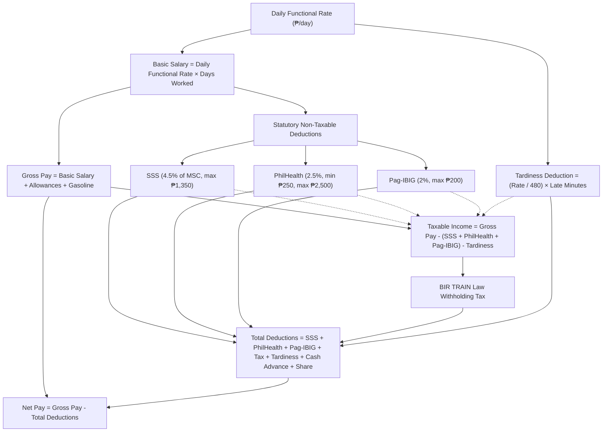

# Philippine Mandatory Government Deductions & Statutory Payroll Computation

This guide provides the authoritative legal foundation and exact computation rules for mandatory Philippine government deductions implemented in the Northern Mindanao Colleges, Inc. HR & Payroll System.

---

## 1. Regulatory Overview

Under Philippine labor and tax laws, private educational institutions and employers are legally mandated to withhold and remit four (4) primary statutory contributions from employee compensation:

1. **Social Security System (SSS)** — *Republic Act No. 11199* (Social Security Act of 2018)
2. **Philippine Health Insurance Corporation (PhilHealth)** — *Republic Act No. 11223* (Universal Health Care Act of 2019)
3. **Home Development Mutual Fund (Pag-IBIG / HDMF)** — *Republic Act No. 9679* & *Pag-IBIG Circular No. 460*
4. **Bureau of Internal Revenue (BIR) Withholding Tax** — *Republic Act No. 10963* (TRAIN Law) & *National Internal Revenue Code (NIRC) Sec. 24(A)(2)(a)*

All computations are implemented in `src/utils/philippineTaxCalculator.ts` and executed during payroll generation in `src/services/payroll.service.ts`.

---

## 2. Statutory Deduction Breakdown & Legal Formulas

### A. Social Security System (SSS)

- **Governing Law:** Republic Act No. 11199 (Social Security Act of 2018).
- **Mandate:** Provides social insurance coverage against contingencies such as sickness, disability, maternity, retirement, and death.
- **Contribution Rate:** 14% total contribution rate, divided into:
  - **Employer Share (ER):** 9.5%
  - **Employee Share (EE):** **4.5%**
- **Monthly Salary Credit (MSC) Range:**
  - **Minimum MSC (Floor):** ₱4,000.00
  - **Maximum MSC (Ceiling):** ₱30,000.00
  - **Step Increment:** Brackets round to the nearest ₱500.00 step.

#### Calculation Logic in Code:
```typescript
export function calculateSss(monthlyBasic: number): number {
  if (monthlyBasic <= 0) return 0;
  // Clamp between statutory minimum (4,000) and maximum (30,000)
  const clampedMsc = Math.min(Math.max(monthlyBasic, 4000), 30000);
  // Round to nearest 500 step
  const mscStep = Math.round(clampedMsc / 500) * 500;
  const employeeRate = 0.045; // 4.5%
  return round(mscStep * employeeRate);
}
```

- **Minimum Employee Deduction:** $\text{₱}4,000 \times 4.5\% = \mathbf{\text{₱}180.00}$
- **Maximum Employee Deduction:** $\text{₱}30,000 \times 4.5\% = \mathbf{\text{₱}1,350.00}$

---

### B. Philippine Health Insurance Corporation (PhilHealth)

- **Governing Law:** Republic Act No. 11223 (Universal Health Care Act of 2019) & PhilHealth Circular No. 2020-0005.
- **Mandate:** Universal health coverage and medical hospitalization subsidies.
- **Contribution Rate:** **5.0%** of basic monthly salary, shared equally:
  - **Employer Share (ER):** 2.5%
  - **Employee Share (EE):** **2.5%**
- **Salary Floor & Ceiling:**
  - **Income Floor:** ₱10,000.00 (Salaries at or below ₱10,000 pay the fixed minimum).
  - **Income Ceiling:** ₱100,000.00 (Salaries at or above ₱100,000 pay the fixed cap).

#### Calculation Logic in Code:
```typescript
export function calculatePhilHealth(monthlyBasic: number): number {
  if (monthlyBasic <= 0) return 0;
  // Clamp between statutory floor (10,000) and ceiling (100,000)
  const clampedBasic = Math.min(Math.max(monthlyBasic, 10000), 100000);
  const employeeRate = 0.025; // 2.5%
  return round(clampedBasic * employeeRate);
}
```

- **Minimum Employee Deduction:** $\text{₱}10,000 \times 2.5\% = \mathbf{\text{₱}250.00}$
- **Maximum Employee Deduction:** $\text{₱}100,000 \times 2.5\% = \mathbf{\text{₱}2,500.00}$

---

### C. Home Development Mutual Fund (Pag-IBIG / HDMF)

- **Governing Law:** Republic Act No. 9679 & Pag-IBIG Circular No. 460 (effective February 2024).
- **Mandate:** National savings and affordable housing loan program.
- **Contribution Rate:**
  - Employees earning above ₱1,500/month contribute **2.0%** of their monthly basic salary.
  - Employers match with **2.0%**.
- **Maximum Fund Salary (MFS) Cap:**
  - Capped at **₱10,000.00** Maximum Fund Salary under Circular 460.
  - Statutory mandatory maximum employee contribution: $\text{₱}10,000 \times 2\% = \mathbf{\text{₱}200.00}$.

#### Calculation Logic in Code:
```typescript
export function calculatePagIbig(monthlyBasic: number): number {
  if (monthlyBasic <= 0) return 0;
  const raw = monthlyBasic * 0.02; // 2%
  return round(Math.min(raw, 200)); // Capped at ₱200.00
}
```

- **Mandatory Employee Deduction:** Fixed at $\mathbf{\text{₱}200.00}$ for employees earning $\ge \text{₱}10,000/\text{month}$.

---

### D. Bureau of Internal Revenue (BIR) Withholding Tax on Compensation

- **Governing Law:** Republic Act No. 10963 (TRAIN Law) & NIRC Section 24(A)(2)(a), implemented via BIR Revenue Regulations No. 8-2018.
- **Mandate:** Pay-As-You-Earn (PAYE) withholding tax on employee compensation income.

#### Statutory Exclusion of Contributions:
Under Section 32(B)(7)(f) of the NIRC, mandatory employee contributions to SSS, PhilHealth, and Pag-IBIG are **non-taxable** exclusions from gross income. Tardiness/undertime is also excluded because unworked hours do not represent earned income:

$$\text{Taxable Income} = \text{Gross Pay} - (\text{SSS} + \text{PhilHealth} + \text{Pag-IBIG}) - \text{Tardiness Deduction}$$

#### Revised Monthly Graduated Tax Brackets:

| Tax Bracket | Monthly Taxable Income Range | Basic Withholding Tax | Prescribed Rate on Excess |
| :---: | :--- | :---: | :--- |
| **1** | ₱0.00 to ₱20,833.33 | **₱0.00** | 0.0% (Exempt) |
| **2** | ₱20,833.34 to ₱33,332.99 | **₱0.00** | + 15% of excess over ₱20,833.00 |
| **3** | ₱33,333.00 to ₱66,666.99 | **₱1,875.00** | + 20% of excess over ₱33,333.00 |
| **4** | ₱66,667.00 to ₱166,666.99 | **₱8,541.80** | + 25% of excess over ₱66,667.00 |
| **5** | ₱166,667.00 to ₱666,666.99 | **₱33,541.80** | + 30% of excess over ₱166,667.00 |
| **6** | ₱666,667.00 and above | **₱183,541.80** | + 35% of excess over ₱666,667.00 |

#### Semi-Monthly Graduated Tax Brackets (Cutoff Periods):

| Tax Bracket | Semi-Monthly Taxable Income Range | Basic Withholding Tax | Prescribed Rate on Excess |
| :---: | :--- | :---: | :--- |
| **1** | ₱0.00 to ₱10,417.00 | **₱0.00** | 0.0% (Exempt) |
| **2** | ₱10,417.01 to ₱16,666.00 | **₱0.00** | + 15% of excess over ₱10,417.00 |
| **3** | ₱16,666.01 to ₱33,333.00 | **₱937.50** | + 20% of excess over ₱16,666.00 |
| **4** | ₱33,333.01 to ₱83,333.00 | **₱4,270.90** | + 25% of excess over ₱33,333.00 |
| **5** | ₱83,333.01 to ₱333,333.00 | **₱16,770.90** | + 30% of excess over ₱83,333.00 |
| **6** | ₱333,333.01 and above | **₱91,770.90** | + 35% of excess over ₱333,333.00 |

---

### E. Tardiness & Undertime Deduction

- **Daily Standard Hours:** 8 hours/day (480 minutes/day).
- **Formulas:**
  $$\text{Hourly Rate} = \frac{\text{Daily Functional Rate}}{8}$$
  $$\text{Minute Rate} = \frac{\text{Hourly Rate}}{60} = \frac{\text{Daily Functional Rate}}{480}$$
  $$\text{Tardiness Deduction} = \text{Minute Rate} \times \text{Late Minutes}$$

---

## 3. End-to-End Payroll Processing Flow



---

## 4. Complete Worked Example

Assume a full-time employee with the following compensation parameters:
- **Daily Functional Rate:** ₱1,500.00 / day
- **Days Worked (Monthly Cutoff):** 22 days
- **Allowances / COLA:** ₱3,000.00
- **Gasoline Allowance:** ₱1,000.00
- **Tardiness Minutes:** 30 minutes
- **Outstanding Cash Advance:** ₱0.00

### Step 1: Gross Pay Calculation
$$\text{Basic Salary} = \text{₱}1,500.00 \times 22 = \text{₱}33,000.00$$
$$\text{Gross Pay} = \text{₱}33,000.00 + \text{₱}3,000.00 + \text{₱}1,000.00 = \mathbf{\text{₱}37,000.00}$$

### Step 2: Tardiness Deduction
$$\text{Minute Rate} = \frac{\text{₱}1,500.00}{480} = \text{₱}3.125/\text{min}$$
$$\text{Tardiness Deduction} = \text{₱}3.125 \times 30 = \mathbf{\text{₱}93.75}$$

### Step 3: Mandatory Statutory Deductions
1. **SSS Employee Share:**
   - Basic Salary is ₱33,000.00 $\rightarrow$ capped at maximum MSC ₱30,000.00.
   - $\text{SSS} = \text{₱}30,000.00 \times 4.5\% = \mathbf{\text{₱}1,350.00}$
2. **PhilHealth Employee Share:**
   - $\text{PhilHealth} = \text{₱}33,000.00 \times 2.5\% = \mathbf{\text{₱}825.00}$
3. **Pag-IBIG Employee Share:**
   - $\text{Pag-IBIG} = \min(\text{₱}33,000.00 \times 2\%, 200) = \mathbf{\text{₱}200.00}$
4. **Total Statutory Contributions:**
   $$\text{Total Statutory} = \text{₱}1,350.00 + \text{₱}825.00 + \text{₱}200.00 = \mathbf{\text{₱}2,375.00}$$

### Step 4: Taxable Income Calculation
$$\text{Taxable Income} = \text{₱}37,000.00 - \text{₱}2,375.00 - \text{₱}93.75 = \mathbf{\text{₱}34,531.25}$$

### Step 5: BIR Withholding Tax (TRAIN Law Bracket 3: ₱33,333 to ₱66,666)
- Base Tax: ₱1,875.00
- Excess over ₱33,333.00: $\text{₱}34,531.25 - \text{₱}33,333.00 = \text{₱}1,198.25$
- Tax on excess ($20\%$): $\text{₱}1,198.25 \times 0.20 = \text{₱}239.65$
- **Total Tax Withheld:** $\text{₱}1,875.00 + \text{₱}239.65 = \mathbf{\text{₱}2,114.65}$

### Step 6: Total Deductions and Net Take-Home Pay
$$\text{Total Deductions} = \text{₱}2,375.00 (\text{Statutory}) + \text{₱}2,114.65 (\text{Tax}) + \text{₱}93.75 (\text{Tardiness}) = \mathbf{\text{₱}4,583.40}$$
$$\text{Net Pay} = \text{₱}37,000.00 - \text{₱}4,583.40 = \mathbf{\text{₱}32,416.60}$$

---

## 5. Semi-Monthly Cutoff Adjustments

When payroll is generated on a **semi-monthly cutoff** (1st half / 2nd half):
1. **Statutory Contributions Split:** SSS, PhilHealth, and Pag-IBIG contributions are divided by 2 across each 15-day payroll cycle.
2. **Semi-Monthly Tax Tables:** Withholding tax applies the semi-monthly TRAIN brackets (Bracket 1 exempt up to ₱10,417.00).
3. **Allowances:** Standard recurring allowances are amortized half-and-half across the two cutoffs.
